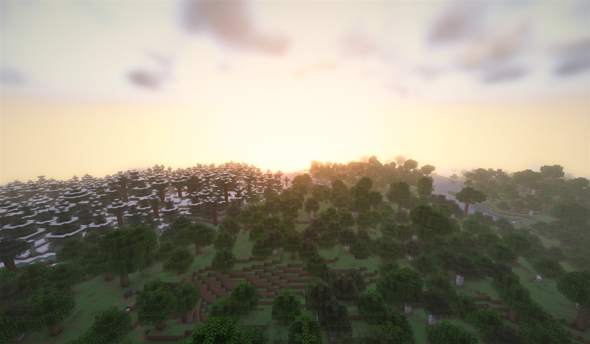
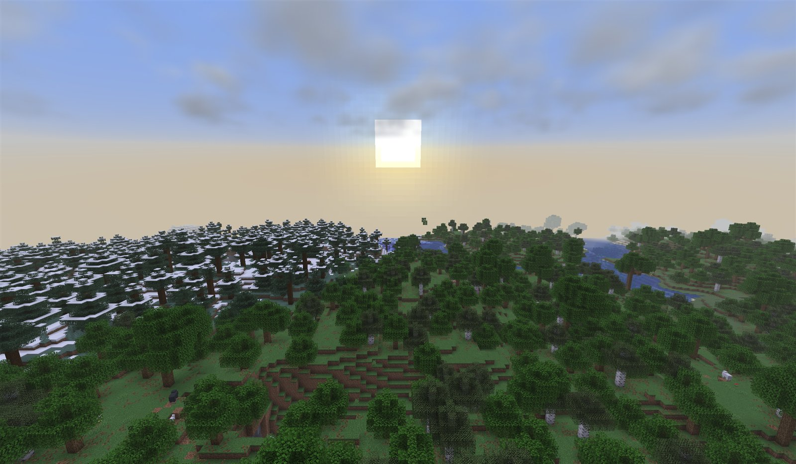
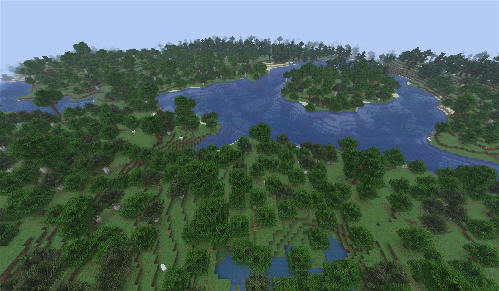
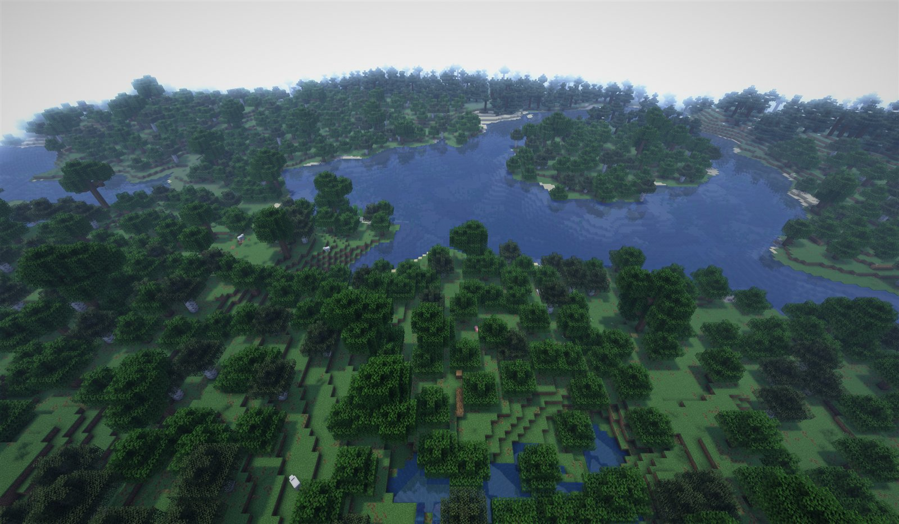
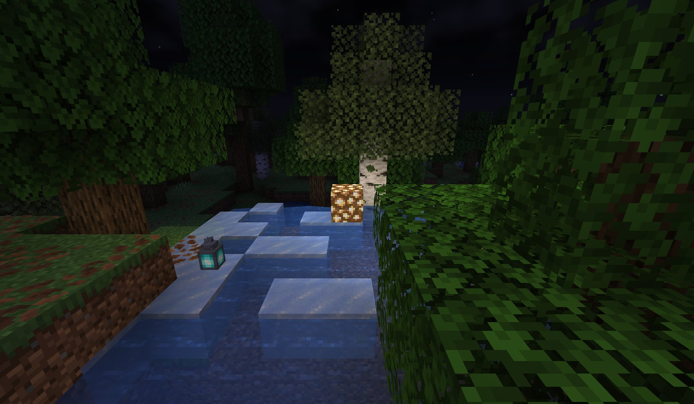
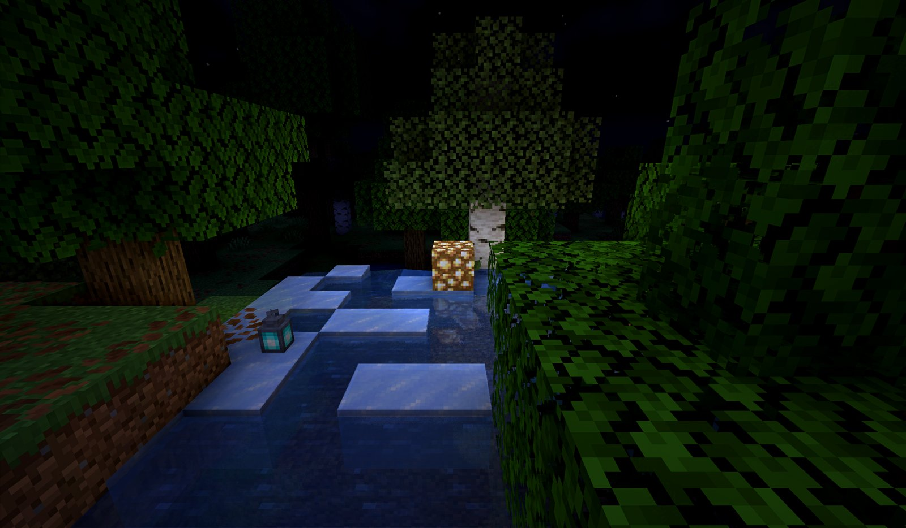
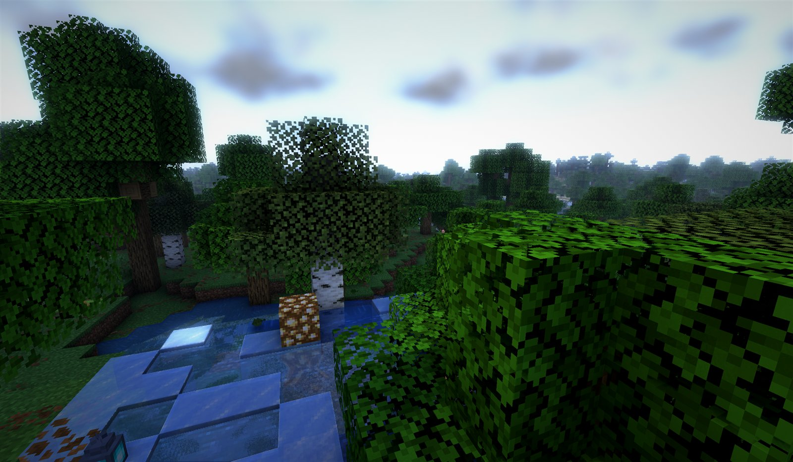
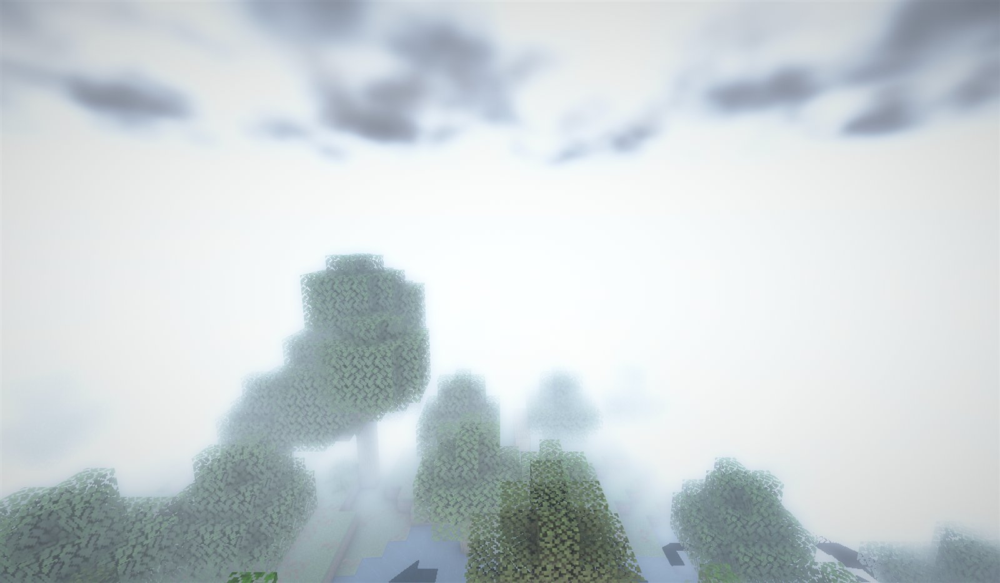

# Vanilla Shader

A NeoForge mod for Minecraft **26.1.2** that gives the game a vibrant, shader-like look while staying compatible
with **Sodium** and **WeatherStory**. Everything is post-processing on top of the normal renderer, so no shader pack
loader is needed.



## Screenshots

All shots use the Max profile together with Sodium and WeatherStory; "vanilla" is the same view with the mod off.

| Vanilla | Vanilla Shader (Max) |
|---|---|
|  |  |
|  |  |
|  |  |

| Forest with sun shadows and ice | WeatherStory mist |
|---|---|
|  |  |

## Features

- **Graphics profiles:** Off, Low, Medium, High, Max and Custom. Press **F6** to cycle them in game.
- **Sun shadows:** cast by terrain, trees and buildings, including occluders off screen. Short contact shadows add fine detail.
- **Cloud shadows:** from WeatherStory's clouds. With Sodium installed this mod draws them, because WeatherStory's own terrain shader is replaced by Sodium.
- **Water:**
  - screen-space reflections, a sun glint and pixel-snapped ripples;
  - ice and glass are recognised and left alone;
  - under water: caustics, depth tint and a gentle wobble.
- **Light and atmosphere:** ambient occlusion, bloom, god rays, a sun-tinted haze over distant terrain, colour grading and a vignette.
- **Dynamic lighting:** smooth, coloured light from:
  - torches, lanterns, glowstone and other light sources, whether held, dropped or placed;
  - glowing mobs, as bright as they glow (the Warden's heartbeat, a creeper about to explode, Enderman eyes, Blazes, glow squids, fireballs, ...);
  - lightning.
- **WeatherStory integration:** mist and sandstorms keep their look, and clouds and storms dim the sun effects.
- **AMD FSR 1 upscaling:** a render scale per profile and a sharpness slider. The HUD always stays sharp.
- **Settings:** in Sodium's Video Settings (a "Vanilla Shader" page) or in NeoForge's config screen. The Look page has a reset button.

## Requirements

- Minecraft 26.1.2 with NeoForge 26.1.2.122 or newer
- Optional: [Sodium](https://modrinth.com/mod/sodium) 0.9.2+ and WeatherStory 0.9.1+

The mod turns itself off while an Iris shader pack is active.

## Building

```bash
./gradlew build
```

The jar ends up in `build/libs/`. Java 25 is downloaded automatically through the Gradle toolchain.

For development, `./gradlew runClient -PdevCapture=...` loads `run/saves/world` and saves a screenshot per profile.
Add `-Pjvm.vanillashader.profilePasses=true` to log GPU timings for every pass. See `DevCapture` and `PassTimer`.

## Notes

- **GPU compatibility:** shaders stick to strict GLSL 3.30 and are checked at build time (`./gradlew validateShaders`, part of `check`) with glslang plus a check for names NVIDIA and Intel reject. If a shader still fails on some driver, only that effect turns off and the log names it; the game keeps running.
- **GPU choice on laptops:** with both an integrated and a dedicated GPU, make sure Java (`javaw.exe`) runs on the dedicated one, under Windows Settings → Display → Graphics. Otherwise performance is much lower.
- **No Vulkan, no DLSS:** Minecraft 26.1.2 only has an OpenGL renderer, and DLSS does not support OpenGL.

## Credits

- **Authors:** Stefan / Claude Code
- **FSR 1:** the EASU and RCAS shaders are GLSL ports of AMD FidelityFX Super Resolution 1.0, © 2021 Advanced Micro Devices, Inc., MIT License.

## License

[MIT](LICENSE)
