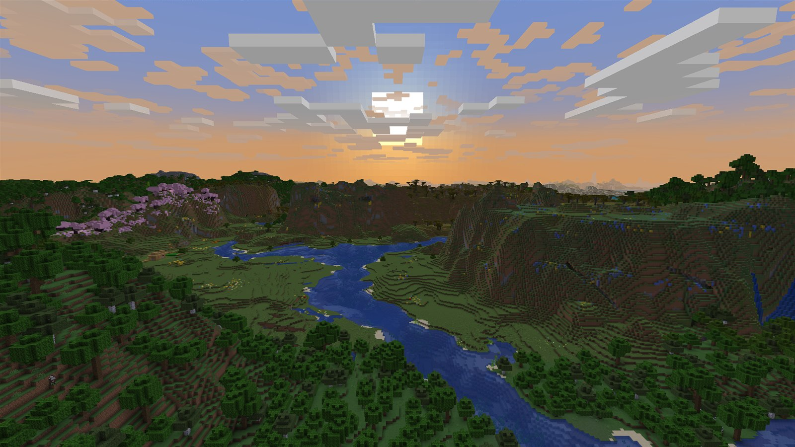
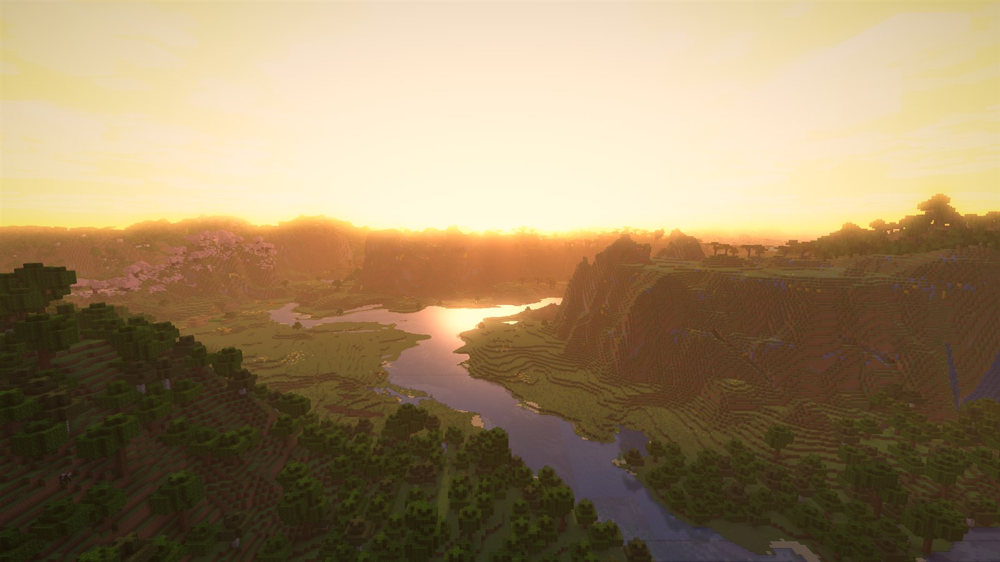
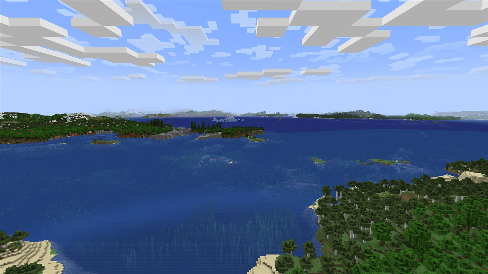
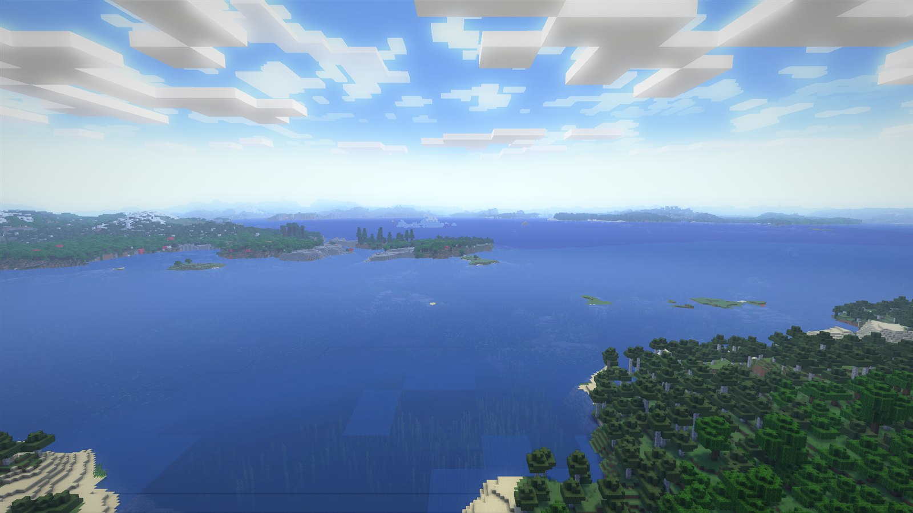
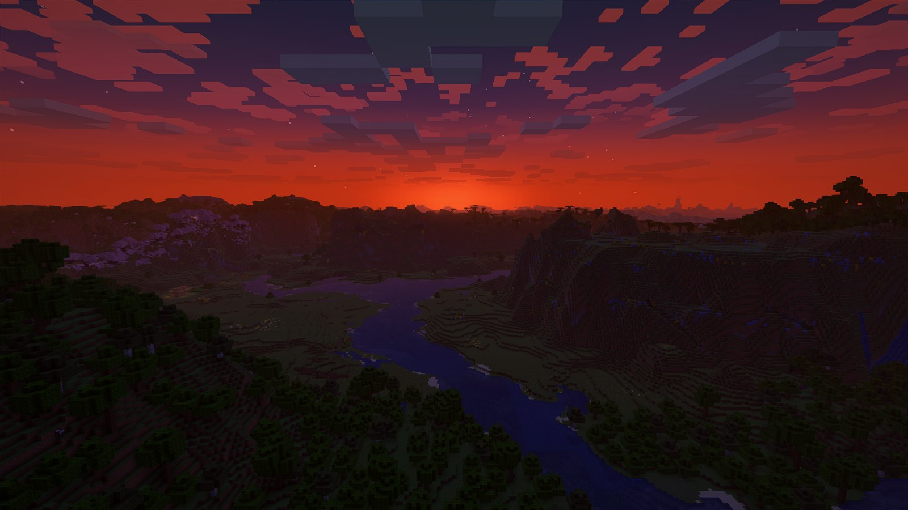
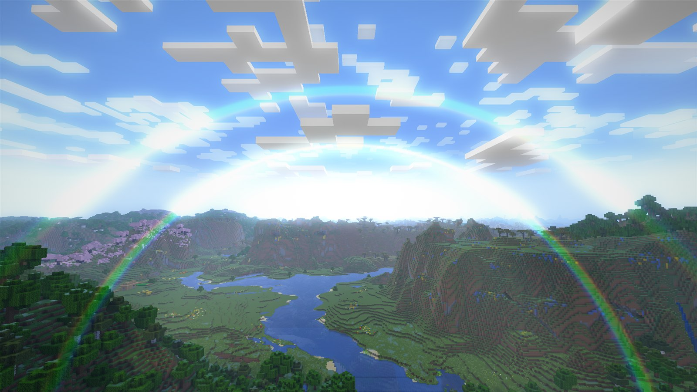
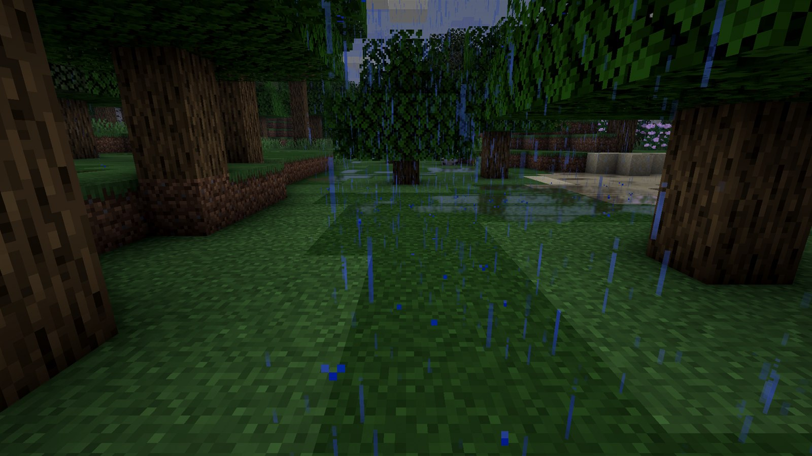
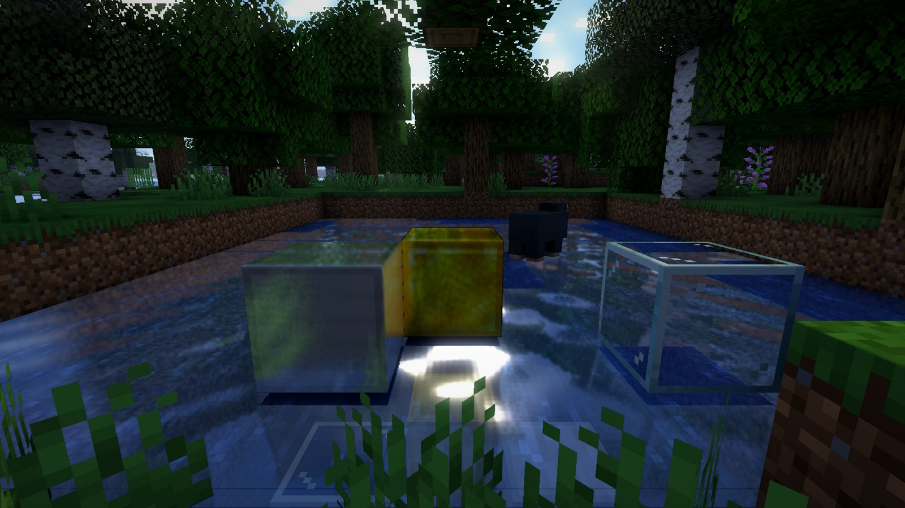

# Vanilla Shader

A NeoForge mod for Minecraft **1.21.1, 26.1.2, 26.2 and 26.3** that gives the game a vibrant, shader-like look while staying compatible
with **Sodium**, **WeatherStory** and **Distant Horizons**. Everything is post-processing on top of the normal renderer, so no
shader pack loader is needed.


## Screenshots

All shots use the Max profile together with Sodium and WeatherStory; "vanilla" is the same view with the mod off.

| Vanilla | Vanilla Shader (Max) |
|---|---|
|  |  |
|  |  |
|  |  |

| Forest with sun shadows and ice | WeatherStory mist |
|---|---|
|  |  |

### New in 1.2

These shots use the Max profile with Sodium and Distant Horizons on Minecraft 1.21.1.

| Vanilla with Distant Horizons | Vanilla Shader (Max) |
|---|---|
|  |  |
|  |  |

| Afterglow after sunset | Rainbow after the rain |
|---|---|
|  |  |

| Rain: wet ground and puddles | Ray-traced reflections on iron, gold and glass |
|---|---|
|  |  |

## Features

- **Graphics profiles:** Off, Low, Medium, High, Max, Auto and Custom. Press **F6** to cycle them in game.
- **Auto profile:** measures the frame rate while you play and steps effects and FSR render scale up or down to hold
  a target frame rate (30 to 240 FPS, a slider in the settings). It takes vsync and Minecraft's frame rate limit into
  account, does not keep bouncing between two steps, and does not lower quality when that would not help (when the
  CPU is what holds the frame rate back).
- **Sun shadows:** cast by terrain, trees and buildings, including occluders off screen. Short contact shadows add fine detail.
- **Cloud shadows:** from WeatherStory's clouds. With Sodium installed this mod draws them, because WeatherStory's own terrain shader is replaced by Sodium.
- **Water:**
  - screen-space reflections, a sun glint and pixel-snapped ripples;
  - ice and glass are recognised and left alone;
  - under water: caustics, depth tint and a gentle wobble.
- **Light and atmosphere:** ambient occlusion, bloom, god rays, a sun-tinted haze over distant terrain, colour grading and a vignette.
- **Golden hour:** in the last stretch before sunset (and the first after sunrise) the sky and clouds turn amber around a glowing sun, the light turns orange and terrain facing away from the sun becomes a dark silhouette. Rain and thick fog tone it down.
- **Afterglow:** once the sun is below the horizon, the sky on its side glows deep red, with pink and violet above it and red-lit clouds, fading as the sun sinks deeper; the same before sunrise.
- **Sun and moon:** looking into the sun gives a lens flare (a small halo, a thin streak and a few coloured ghosts) that fades as terrain hides it; the moon gets a cool glow, the faint 22 degree halo ring and a quieter flare. The sky itself is kept out of the bloom and rolls off instead of clipping, so it stays blue around the sun.
- **Quick to join:** the shaders are compiled one at a time on the title and loading screens, so entering a world does not stall on them.
- **Ray-traced lighting** (optional toggle, off by default): rays traced through a voxel copy of the blocks around you. Lava, glowstone, fire and other light blocks light up their surroundings in their own colour, also from off screen, and obsidian, metal blocks, glass, ice and polished stone get glossy reflections. This is not hardware ray tracing (RTX): the rays run in an ordinary shader, on OpenGL and Vulkan alike.
- **Dimensions:** the Nether and the End get their own treatment (no sun effects, the End sky flashes light the world). Modded dimensions such as The Aether II or Stellaris are handled the same way, by whether they have a sun; they are not tested separately.
- **Dynamic lighting:** smooth, coloured light from:
  - torches, lanterns, glowstone and other light sources, whether held, dropped or placed;
  - glowing mobs, as bright as they glow (the Warden's heartbeat, a creeper about to explode, Enderman eyes, Blazes, glow squids, fireballs, ...);
  - lightning.
- **Rain:** what the rain falls on turns wet and darker, puddles form on open ground and reflect the sky, and drops
  ripple water and puddles. It dries up again after the rain.
- **Rainbows:** when the sun breaks through rain or wet air, a primary and a fainter secondary bow appear opposite
  the sun.
- **Other dimensions:** modded sky dimensions with a white sky (The Aether II) get less haze and bloom; airless ones
  (the moons and planets of Stellaris) get no golden hour or haze.
- **WeatherStory integration:** mist and sandstorms keep their look, and clouds and storms dim the sun effects.
- **Distant Horizons integration** (DH 3.3 or newer):
  - its far-away terrain is shaded like the rest: haze at its real distance, sunny and shaded sides, sunset
    silhouettes, sky reflections on distant seas, and lit clouds; or, with that setting off, left exactly as DH draws
    it while our effects fade out towards the render distance;
  - the chunks' shadows hand over smoothly to the distant terrain;
  - a switch in the settings turns DH's drawing off and on (DH's own settings are left alone), and at game start a
    prompt asks whether to use DH this time (with "don't show again").
- **AMD FSR 1 upscaling:** a render scale per profile and a sharpness slider. The HUD always stays sharp.
- **Settings:** in Sodium's Video Settings (a "Vanilla Shader" page), or without Sodium through a "Vanilla Shader..." button in Minecraft's own Video Settings, and in NeoForge's config screen. The Look page has a reset button.
- **Languages:** English, Dutch, German, French, Spanish, Brazilian Portuguese, Italian, Polish, Russian, Ukrainian, Turkish, Simplified and Traditional Chinese, Japanese and Korean.

## Requirements

There is a separate jar for each Minecraft version (`vanillashader-<version>+mc<minecraft>.jar`):

| Minecraft | NeoForge | Sodium (optional) | Notes |
|---|---|---|---|
| 1.21.1 | 21.1.200 or newer | 0.8.13+ | WeatherStory is not available |
| 26.1.2 | 26.1.2.122 or newer | 0.9.2+ | WeatherStory 0.9.1+ (optional) |
| 26.2 | 26.2.0.93 or newer | 0.9.2+ | |
| 26.3 | 26.3.0.99 or newer | 0.9.3+ | Works with Improved Transparency on or off |

On 26.2 and 26.3 the mod works with both graphics APIs, OpenGL and Vulkan. On 26.2, NeoForge itself can only start
with Vulkan when its early loading screen is off (`earlyWindowControl = false` in `config/fml.toml`); that is not
specific to this mod.

Distant Horizons is optional, from version 3.3 (all four Minecraft versions). The mod turns itself off while an Iris
shader pack is active.

## Building

```bash
./gradlew build
```

The build uses [Stonecutter](https://stonecutter.kikugie.dev/): one source tree, built once per Minecraft version, with
`//?` comments where versions differ (versions and their dependencies are in `stonecutter.properties.toml`). The jars
end up in `versions/<minecraft>/build/libs/`. Java 25 (26.x) and Java 21 (1.21.1) are downloaded automatically
through the Gradle toolchain. The GPU code (`client/gpu`) uses Minecraft's own GPU API on 26.x and plain OpenGL on
1.21.1 (`src/gl`); the shaders are shared.

For development, `./gradlew :<minecraft>:runClient -PdevCapture=...` loads `saves/world` from the run folder (`run/`
for 26.1.2, `runs/<minecraft>/` for the others) and saves a screenshot per profile. On 1.21.1, add
`-Pjvm.vanillashader.devCapture.newWorldSeed=<seed>` to create that world first.
Add `-Pjvm.vanillashader.profilePasses=true` to log GPU timings for every pass. See `DevCapture` and `PassTimer`.

## Notes

- **GPU compatibility:** shaders stick to strict GLSL 3.30 and are checked at build time (`./gradlew validateShaders`, part of `check`) with glslang plus a check for names NVIDIA and Intel reject. If a shader still fails on some driver, only that effect turns off and the log names it; the game keeps running.
- **GPU choice on laptops:** with both an integrated and a dedicated GPU, make sure Java (`javaw.exe`) runs on the dedicated one, under Windows Settings → Display → Graphics. Otherwise performance is much lower.
- **No DLSS:** DLSS needs hardware and SDKs Minecraft does not expose, on OpenGL or Vulkan; FSR 1 is used instead.

## Credits

- **Authors:** Stefan / Claude Code
- **FSR 1:** the EASU and RCAS shaders are GLSL ports of AMD FidelityFX Super Resolution 1.0, © 2021 Advanced Micro Devices, Inc., MIT License.

## License

[MIT](LICENSE)
